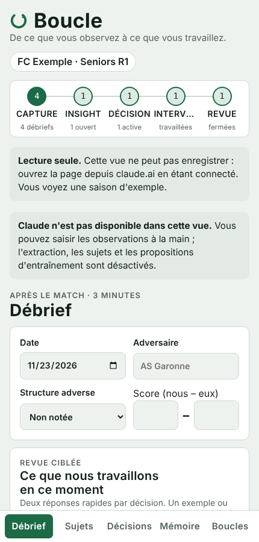

# BOUCLE

Outil d'aide à la décision pour staffs de football : de ce que vous observez à ce que vous travaillez.

## Fonctionnalités

- Débrief d'après-match dicté en trois minutes, structuré en observations à confirmer
- Sujets : au plus trois, avec un niveau de confiance fondé sur le nombre de matchs concernés
- Décisions avec indicateur comptable, propositions d'exercices d'entraînement, revues sur les matchs suivants
- Mémoire du staff interrogeable et vue des boucles fermées, avec garde-fous contre le biais du résultat
- Saison d'exemple fictive pour découvrir l'outil

## Lancer

Ouvrir `index.html`.

## Fonctions connectées

L'enregistrement partagé et l'analyse des débriefs par IA s'activent lorsque la page est publiée comme artefact sur claude.ai, qui fournit un stockage partagé par équipe, l'identité des membres et l'accès à un modèle de langage. Ouverte directement dans un navigateur, l'application bascule en mode local : la page s'ouvre en lecture seule sur la saison d'exemple.

## Technique

Application monofichier en JavaScript sans dépendance, conçue mobile d'abord.

## Statut

Prototype (phase 0).

## Droits

© 2026 Florian Iglesias – Tous droits réservés. Code publié à titre de présentation : aucune licence d'utilisation, de copie ou de redistribution n'est accordée.
