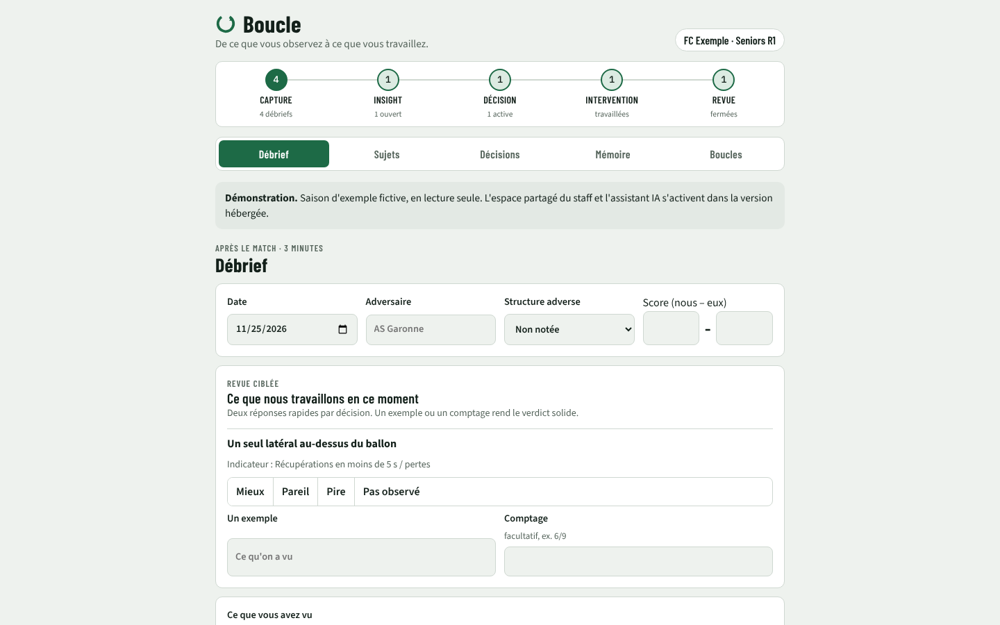
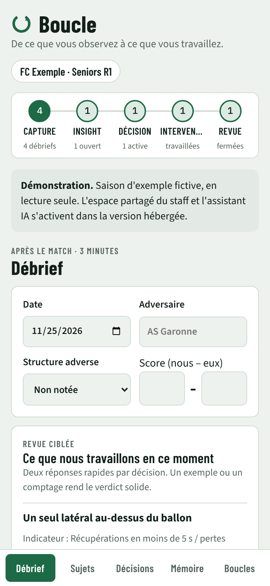

# Boucle — de ce que vous observez à ce que vous travaillez

[](https://github.com/Skysaks/BOUCLE/actions/workflows/ci.yml)

> **EN** — A decision tool for football coaching staffs: post-match debrief → recurring issues → training decisions → review over the next matches, with guardrails against outcome bias.

**Démonstration** : [skysaks.github.io/BOUCLE](https://skysaks.github.io/BOUCLE/) · fichier autonome : [`dist/boucle.html`](dist/boucle.html) (à télécharger et ouvrir, hors ligne, sans installation).



> © 2026 Florian Iglesias — Tous droits réservés. Dépôt public à titre de portfolio uniquement : aucune licence n'est concédée. Voir [LICENSE](LICENSE).

## Le principe

Un staff voit beaucoup de choses pendant un match et en travaille peu la semaine suivante. Entre les deux, l'information se perd : notes dispersées, impressions dictées par le score, décisions dont personne ne vérifie l'effet. Boucle referme ce circuit en cinq étapes visibles en haut de l'écran :

**Capture** (débrief dicté en trois minutes) → **Insight** (au plus trois sujets récurrents) → **Décision** (un indicateur comptable par décision) → **Intervention** (exercices d'entraînement) → **Revue** (mieux, pareil ou pire sur les matchs suivants).

## Fonctionnalités

- **Débrief d'après-match** : le texte libre du coach devient des observations structurées (phase de jeu, principe, joueurs, période, cause avancée, degré de certitude), toutes à confirmer avant enregistrement.
- **Sujets** : au plus trois à la fois, avec un niveau de confiance qui dépend du nombre de matchs concernés (hypothèse, tendance, récurrent), jamais du nombre de phrases.
- **Décisions** : chacune porte un indicateur comptable (« récupérations en moins de 5 s / pertes ») et une durée de revue ; propositions d'exercices adaptées au niveau de l'équipe.
- **Revue ciblée** : deux réponses rapides par décision après chaque match, un exemple ou un comptage pour rendre le verdict solide.
- **Garde-fou contre le biais du résultat** : une décision jugée « mieux » après chaque victoire et « pire » après chaque défaite, sans comptage, est signalée.
- **Mémoire du staff** : questions en langage naturel sur les débriefs, décisions et revues passés, filtrables par phase de jeu, structure adverse et valence.
- **Mobile d'abord** : une colonne de travail, barre d'onglets au pouce sur téléphone ; brouillon du débrief conservé localement.

| Ordinateur | Téléphone |
|---|---|
|  |  |

## Deux modes

| | Démonstration (ce dépôt, GitHub Pages) | Version hébergée |
|---|---|---|
| Données | saison d'exemple fictive (FC Exemple), lecture seule | espace partagé par le staff, temps réel |
| Assistant IA (extraction, sujets, exercices, mémoire) | désactivé, saisie manuelle possible | actif |
| Réseau | aucune requête | API de l'hébergeur uniquement |

Le même fichier sert aux deux : au démarrage, l'application demande à l'hébergeur une base de données, un modèle de langage et l'identité de l'utilisateur ; si rien ne répond, elle bascule en démonstration. Détail : [docs/ARCHITECTURE.md](docs/ARCHITECTURE.md).

## Construire et tester

Node 22 (voir `.nvmrc`). Aucune dépendance d'exécution ; Playwright sert uniquement aux tests.

```bash
npm ci
npm run dev        # http://localhost:5173, reconstruit à chaque modification de src/
npm run build      # src/ → dist/boucle.html (fichier unique, polices embarquées)
npm run verify     # aucune ressource externe, budget de taille, aucune donnée personnelle
npm test           # tests d'intégrité (node:test) + parcours bureau et mobile (Playwright)
npm run captures   # régénère docs/captures/
```

La CI rejoue tout à chaque push : `dist/` doit correspondre exactement aux sources, sinon elle échoue.

## Structure du dépôt

```
src/
  index.html            gabarit : en-tête, coquille de l'interface, ordre des feuilles et des modules
  styles/               00-socle, 00-polices, 01-base, 02-en-tete, 03-chaine, 04-vues
  js/                   01-donnees … 12-demarrage (scripts classiques concaténés dans cet ordre)
  fonts/                Barlow Condensed, Source Sans 3, IBM Plex Mono (woff2, sous-ensemble latin)
dist/boucle.html        fichier construit, autonome (≈ 245 Ko)
scripts/                build, vérification, serveur de développement, captures, site GitHub Pages
tests/                  intégrité du build (node:test) et parcours de bout en bout (Playwright)
docs/                   architecture, captures, licences des polices
```

## Choix techniques

- **Un seul fichier HTML à la sortie.** Le produit doit s'ouvrir depuis une pièce jointe, une clé USB ou un hébergeur d'applications sans serveur : pas de CDN, pas de requête, polices encodées dans la feuille de style.
- **JavaScript sans framework.** L'état tient dans un objet ; chaque action le modifie puis appelle `render()`, qui reconstruit la vue active. À cette taille (≈ 65 Ko de JavaScript), un framework ajouterait plus de code qu'il n'en retirerait.
- **Build maison d'environ 180 lignes** plutôt qu'un bundler : il ne fait qu'insérer les fichiers de `src/` dans le gabarit, ce qui garde `dist/` lisible et vérifiable octet par octet.
- **L'IA propose, le staff décide.** Toute observation extraite passe par une confirmation ; la confiance d'un sujet est calculée sur les matchs, pas laissée au modèle.

## Limites connues

1. **Démonstration en lecture seule** : sans l'hébergeur, rien n'est enregistré hormis le brouillon du débrief.
2. **Pas de compte ni de synchronisation hors de l'hébergeur** : la version connectée dépend de sa base de données et de ses droits (lecture, contributeur).
3. **Exercices proposés par le modèle** : utiles comme point de départ, ils ne remplacent pas le référentiel du club.
4. **Tests automatiques sur Chromium** (bureau et mobile émulé) ; Safari et Firefox ne sont pas couverts par la CI.

## Sécurité et confidentialité

Aucune donnée ne quitte le navigateur en démonstration. En version hébergée, seules les données du staff transitent par l'hébergeur. Signalement des failles : [SECURITY.md](SECURITY.md).

## Licence

© 2026 Florian Iglesias — Tous droits réservés ([LICENSE](LICENSE)). Les polices embarquées restent sous SIL Open Font License 1.1 ([docs/licences/](docs/licences/)). Contributions : [CONTRIBUTING.md](CONTRIBUTING.md).
